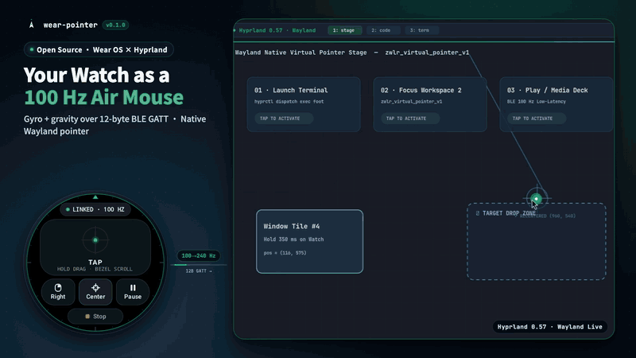

# wear-pointer

**Turn a round Wear OS smartwatch into an eyes-free spatial air mouse — 100 Hz wrist orientation over 20-byte BLE GATT notifications to a 240 Hz 1€-filtered Hyprland cursor.**

[](https://gitlab.com/aa22396584/wear-pointer/-/releases) [](https://gitlab.com/aa22396584/wear-pointer/-/pipelines) [](LICENSE)

> Canonical repository and issues: https://gitlab.com/aa22396584/wear-pointer  
> Releases and downloads: https://gitlab.com/aa22396584/wear-pointer/-/releases

[](https://gitlab.com/aa22396584/wear-pointer/-/raw/main/docs/assets/demo-16x9-en.mp4)

> **Full HD Demo Videos (1080p 30fps):** [16:9 繁體中文](https://gitlab.com/aa22396584/wear-pointer/-/raw/main/docs/assets/demo-16x9-zh.mp4) · [16:9 English](https://gitlab.com/aa22396584/wear-pointer/-/raw/main/docs/assets/demo-16x9-en.mp4) · [9:16 繁體中文 (Reels/Threads)](https://gitlab.com/aa22396584/wear-pointer/-/raw/main/docs/assets/demo-9x16-zh.mp4) · [9:16 English (Shorts/Reels)](https://gitlab.com/aa22396584/wear-pointer/-/raw/main/docs/assets/demo-9x16-en.mp4)


Targeted at Galaxy Watch7 (Wear OS) with a Rust desktop receiver for Omarchy / Hyprland (`zwlr_virtual_pointer_v1`, plus optional Linux `uinput` and `log` backends; macOS and Windows backends are skeletons).

The aiming model is ported from [WatchPointer](https://github.com/umarz317/WatchPointer) by Umar Afzal (MIT): gravity for up/down, integrated gyro for left/right, a [1€ filter](https://gery.casiez.net/1euro/) driven by the watch clock, and a desktop cursor loop at 240 Hz. The watch samples at 100 Hz. Copyright for that work is in [NOTICE](NOTICE). The packet layout and the default Bluetooth direction are new: the watch advertises, the desktop connects.

This tree has **not** been run on a physical Watch7 yet. The full Linux desktop path (Wear OS emulator → `netsim` HCI → `/dev/vhci` → BlueZ → `wear-pointer --backend hyprland` → Hyprland → Wayland client) is verified end to end by [docs/desktop-harness.md](docs/desktop-harness.md). See [Current status](#current-status).

## Layout

| Path | What |
| --- | --- |
| `wearos/` | Kotlin / Jetpack Compose for Wear OS. Sensors, GATT server, tap / hold / right-click / pause / center, rotary scroll. |
| `protocol/` | Protocol v1: UUIDs, packet bytes, the aim test vector. |
| `receiver/` | Rust workspace. `core` (tested motion), `bluetooth` (btleplug central), `platform` (Hyprland, log, optional uinput, macOS/Windows skeletons). |
| `tools/` | End-to-end Linux/Hyprland BLE harness (`tools/harness/`) and Remotion promo video project (`tools/promo/`). |
| `docs/` | Architecture, Stage 0 checklist, acceptance targets, BLE fallback, showcase media (`docs/assets/`). |

## Current status

| Piece | Checked here | Not checked |
| --- | --- | --- |
| Rust `cargo test` (motion, packets, loss, latency, 240 Hz follow) | yes, on Linux | — |
| Rust `cargo build` and `cargo build -p wear-pointer --features uinput` | yes, on Linux | — |
| Wear OS `assembleDebug` and JVM unit tests (29 tests) | yes, JDK 21, compileSdk 35 | not installed on a physical Watch7 |
| Watch7 BLE peripheral, real sensor rate, notify throughput, reconnect | Watch OS app + BlueZ central verified on emulator + `/dev/vhci` ([desktop harness](docs/desktop-harness.md)) | physical Watch7 RF & suspend still need [Stage 0](docs/stage0-hardware-validation.md) |
| Hyprland cursor movement | yes, in QEMU/KVM Hyprland 0.57 (`zwlr_virtual_pointer_v1`, `hyprctl cursorpos`, `wev`) | physical monitor / multi-monitor layout |
| macOS `CGEventPost`, Windows `SendInput` | not compiled (cfg-gated) | skeletons only |
| Desktop-as-peripheral fallback | watch side is written; desktop `--role peripheral` exits with an error | [fallback](docs/fallback-transport.md) |
| Pairing whitelist | no | TODO. The receiver accepts the first matching peripheral. Quit it when you are not using it. |

`--debug` latency is relative to the fastest packet, stamped when the notification is read. It is not a pure radio delay. `aim_hz` uses the watch stats window; `rx` counts every packet kind. Numbers in [docs/acceptance-metrics.md](docs/acceptance-metrics.md) are targets, not measurements.

CI jobs require both tags `r9700x` and `docker` (runner 57287642). `r9700x-docker` is that runner's description, not a tag. Shared runners do not have this pair. The `yes | sdkmanager` pipe is not used; it exits 141 under `pipefail` even when sdkmanager succeeds. CI covers unit tests and builds only, not Watch7 or Hyprland behaviour. [docs/emulator-harness.md](docs/emulator-harness.md) runs the watch app against a second emulator on macOS; [docs/desktop-harness.md](docs/desktop-harness.md) runs the watch emulator over `/dev/vhci` into real BlueZ, `wear-pointer`, Hyprland, and `wev`. Neither replaces Stage 0 on a physical Watch7.

Stop on the watch is the Stop button. Pause tracks while awake (wake lock off, sensors still registered). A gyro timestamp hole over 500 ms, while paused or active, recenters. If Stop did not run: `adb shell am force-stop dev.wearpointer` (`-s <serial>` when several devices are attached).

## Install from release

Signed Wear OS APKs, Linux `x86_64` receiver tarballs (built with `hyprland`, `log`, and `uinput` backends), and `SHA256SUMS.txt` are published on [GitLab Releases](https://gitlab.com/aa22396584/wear-pointer/-/releases):

```bash
# Verify checksums after downloading from https://gitlab.com/aa22396584/wear-pointer/-/releases
sha256sum -c SHA256SUMS.txt

# 1. Install the signed Wear OS APK onto your watch over ADB
adb install -r wear-pointer-v0.1.0-wearos.apk

# 2. Extract and run the Linux x86_64 receiver (Hyprland / log / uinput)
tar -xzf wear-pointer-v0.1.0-x86_64-linux.tar.gz
./wear-pointer-v0.1.0-x86_64-linux/wear-pointer --debug --backend log
./wear-pointer-v0.1.0-x86_64-linux/wear-pointer --debug
```

## Build the receiver

Rust 1.89 or newer (this checkout was tested with 1.100). BlueZ headers are a build dependency on Linux (`libdbus-1-dev`, `pkg-config`).

```bash
cd receiver
cargo test
cargo build -p wear-pointer --release
```

Optional relative uinput backend (also needs permission on `/dev/uinput` at run time):

```bash
cargo build -p wear-pointer --features uinput
```

## Run the receiver

Stage 0, no cursor movement, one debug line per second:

```bash
cd receiver
cargo run -p wear-pointer -- --debug --backend log
```

On a Hyprland session (`WAYLAND_DISPLAY` set), the default backend is Hyprland. Pass `--backend log` until Stage 0 looks sane.

```bash
cargo run -p wear-pointer --release -- --debug
```

```text
wear-pointer [--debug] [--role central|peripheral]
             [--backend hyprland|log|uinput]
             [--speed 1.0] [--steady 0.8] [--quick 0.01]
             [--dead-zone 0.0] [--screen 1920x1080]
             [--adapter hci1] [--trace FILE]
```

`--speed` matches WatchPointer: higher reaches the edge of the screen with less turn. `--dead-zone` is degrees of aim to ignore. Leave it at 0 unless a log shows a reason; WatchPointer removed a dead zone because the cursor walked. `--steady` and `--quick` are the 1€ filter's still cutoff (Hz) and speed coefficient.

`--role peripheral` is the documented fallback (desktop advertises). It is not implemented and exits with an explanation.

## Build the watch app

Wear OS 4 / 5, min SDK 33. Open `wearos/` in Android Studio, or:

```bash
cd wearos
export ANDROID_HOME="$HOME/android-sdk"
./gradlew :app:assembleDebug :app:testDebugUnitTest
adb install -r app/build/outputs/apk/debug/app-debug.apk
```

No signing keys are in the repo. Release APKs on GitLab Releases are signed with the maintainer upload keystore kept outside the tree (`wearos/key.properties`, gitignored); source debug builds use the local debug keystore that Android Gradle Plugin creates automatically.

On the watch: open the app, grant Bluetooth, leave it in the foreground. Point the 12 o'clock chevron (`▲`) at the screen and tap **Center** so both the desktop cursor and the spatial reticle puck sit in the middle. Tap the central pad to left-click, hold about 350 ms until the emerald ring locks to drag, use **Right** / **Center** / **Pause** in the chord-safe dock, **Stop** / **Start** at 6 o'clock, and rotate the bezel or crown to scroll. Tap the top status capsule (e.g. `LINKED · 100 HZ`) to open live sensor/GATT telemetry and the BLE role switch.

If the watch reports that it cannot advertise, read [docs/fallback-transport.md](docs/fallback-transport.md). The watch can switch to "desktop advertises". The desktop half of that role is still a stub.

Full hardware steps: [docs/stage0-hardware-validation.md](docs/stage0-hardware-validation.md).

## Protocol

[protocol/SPEC.md](protocol/SPEC.md). Service UUID `7a1e0001-4c3b-4e2a-9f10-6d5c4b3a2910`. Packets are at most 20 bytes and carry a sequence number and a microsecond watch timestamp so the receiver can count loss and relative latency.

## License

MIT, [LICENSE](LICENSE). WatchPointer's MIT notice is in [NOTICE](NOTICE).
