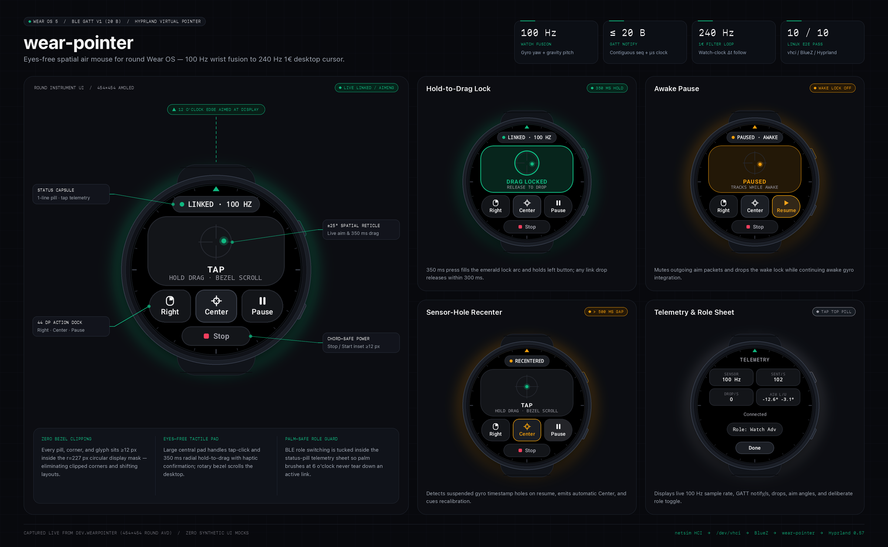

# wear-pointer

**Turn a round Wear OS smartwatch into an eyes-free spatial mouse — with built-in zero-install Standard Bluetooth HID (`BT HID`) for any computer/tablet, plus a native 240 Hz Menu Bar / System Tray receiver (`BLE APP`) and full developer CLI for Linux (Hyprland / uinput), macOS, and Windows.**

[](https://gitlab.com/aa22396584/wear-pointer/-/releases) [](https://gitlab.com/aa22396584/wear-pointer/-/pipelines) [](LICENSE)

> Canonical repository and issues: https://gitlab.com/aa22396584/wear-pointer  
> Releases and downloads: https://gitlab.com/aa22396584/wear-pointer/-/releases
> **Get the Wear OS app:** [Google Play (optional paid support)](https://play.google.com/store/apps/details?id=dev.wearpointer.app) · [Free signed APK (GitLab Releases)](https://gitlab.com/aa22396584/wear-pointer/-/releases)  
> The Play URL uses the release app ID `dev.wearpointer.app`; public listing visibility depends on publication and region. The signed APK and source remain free.

[](https://gitlab.com/aa22396584/wear-pointer/-/raw/main/docs/assets/demo-16x9-en.mp4)

> **Full HD Demo Videos (1080p 30fps):** [16:9 繁體中文](https://gitlab.com/aa22396584/wear-pointer/-/raw/main/docs/assets/demo-16x9-zh.mp4) · [16:9 English](https://gitlab.com/aa22396584/wear-pointer/-/raw/main/docs/assets/demo-16x9-en.mp4) · [9:16 繁體中文 (Reels/Threads)](https://gitlab.com/aa22396584/wear-pointer/-/raw/main/docs/assets/demo-9x16-zh.mp4) · [9:16 English (Shorts/Reels)](https://gitlab.com/aa22396584/wear-pointer/-/raw/main/docs/assets/demo-9x16-en.mp4)



Validated on a physical **Samsung Galaxy Watch7 (`SM-L310`, Wear OS 6 / Android 16)** with two connection tracks and three live-switchable pointing modes (`LASER` absolute aim, `AIR` relative gyro air mouse, and `TOUCH` watch-face touchpad):

1. **Zero-Install Standard Bluetooth HID (`BT HID`)**: Uses Android's `BluetoothHidDevice` profile directly on the watch so macOS, Windows, Linux, iPadOS, and smart TVs pair with the watch like any Bluetooth mouse — **zero software required on the computer**.
2. **240 Hz Spatial BLE Receiver (`BLE APP`)**: Streams 20-byte 100 Hz BLE GATT packets to a tiny native desktop app (macOS **Menu Bar** `.dmg`, Windows **System Tray** `WearPointer.exe` with no console window, Linux `StatusNotifierItem` + `systemd --user`) and preserves the full **`wear-pointer` developer CLI**.

The default `LASER` aiming model is ported from [WatchPointer](https://github.com/umarz317/WatchPointer) by Umar Afzal (MIT): gravity for up/down, integrated gyro for left/right, a [1€ filter](https://gery.casiez.net/1euro/) driven by the watch clock, and a desktop cursor loop at 240 Hz. Alongside `LASER`, `wear-pointer` adds **`AIR`** (relative gyroscope air mouse with smooth radial deadband, Nancel sigmoid speed-gain acceleration, Pause-as-clutch, and zero recentering) and **`TOUCH`** (100 Hz watch-face touchpad with `6–45 px/mm` finger-speed acceleration, tap-to-click, and 350 ms hold-to-drag). In relative modes, moving a physical mouse or trackpad seamlessly hands off its OS cursor coordinates to the watch. Copyright for WatchPointer is in [NOTICE](NOTICE).

Physical hardware measurements across all three desktop OSes (`100.4–102.6 pkt/s`, `0.0%` sequence loss, `10.6–13.2 ms` mean relative latency on Omarchy BlueZ, `6.6–10.6 ms` on Windows 11 WinRT, and `7.1–11.9 ms` on macOS CoreBluetooth) are documented in [docs/acceptance-metrics.md](docs/acceptance-metrics.md), [docs/evidence/README.md](docs/evidence/README.md), and [docs/stage0-hardware-validation.md](docs/stage0-hardware-validation.md), alongside automated CI harnesses in [docs/desktop-harness.md](docs/desktop-harness.md).

## Quick start (regular users)

### Path A — No computer software needed (`BT HID` Bluetooth Mouse)

1. Install **Wear Pointer** on your Wear OS watch via [Google Play (optional paid support)](https://play.google.com/store/apps/details?id=dev.wearpointer.app) if available, or download the [free signed Wear OS APK](https://gitlab.com/aa22396584/wear-pointer/-/releases/v0.3.0) (`wear-pointer-v0.3.0-wearos.apk`).
2. Open the app on your watch, tap the top status pill (`100HZ · 1600 DPI`), tap **`BT HID`**, then tap **`Pair PC`**.
3. Open **Bluetooth Settings** on your Mac, Windows PC, Linux desktop, iPad, or TV and pair with your watch.
4. Move your wrist or slide on the pad — `LASER`, `AIR`, `TOUCH`, left/right click, hold-to-drag, rotary bezel scroll, and live DPI (`400–3200 DPI`) all work immediately.

### Path B — 240 Hz Desktop Menu Bar / System Tray App (`BLE APP`)

Download the installer for your OS from [GitLab Releases](https://gitlab.com/aa22396584/wear-pointer/-/releases) and keep the watch on **`BLE APP`** (the default):

- **macOS (`WearPointer-v0.3.1-aarch64-macos.dmg`)**:
  1. Open the `.dmg` and drag **`WearPointer.app`** into **`Applications`**. (If downloaded with Safari/Chrome, clear Gatekeeper quarantine once: `xattr -dr com.apple.quarantine /Applications/WearPointer.app`.)
  2. Double-click **`WearPointer`** in `Applications` — a crosshair icon appears in the **top-right macOS Menu Bar** (no Dock clutter).
  3. Grant **Bluetooth** and **Accessibility** when prompted (or click **Grant Accessibility Permission…** inside the Menu Bar menu). From the Menu Bar you can see watch battery, Pause, Re-center, choose **Target Display** on multi-monitor desks, override Mode/DPI, or toggle **Start at Login**.
- **Windows 11 (`wear-pointer-v0.3.1-x86_64-windows.zip`)**:
  1. Extract the `.zip` and double-click **`WearPointer.exe`** (runs silently with **no black console window**).
  2. Right-click the crosshair icon in the **bottom-right System Tray** to view connection status & battery, Pause, Re-center, pick **Target Display**, switch Mode/DPI, open logs, or enable **Start with Windows**.
- **Linux / Omarchy (`wear-pointer-v0.3.1-x86_64-linux.tar.gz`)**:
  1. Extract and run `./install-linux.sh` (no `sudo` required): installs `~/.local/bin/wear-pointer-app`, `~/.local/bin/wear-pointer`, desktop launcher entry, and enables the `systemd --user` service (`wear-pointer.service`) with `StatusNotifierItem` system tray support for Waybar / KDE / AppIndicator.
  2. To remove later: `./install-linux.sh --uninstall`.

### Multi-monitor desks

Multi-monitor setups (side-by-side, stacked, L-shaped, mixed HiDPI, and negative-coordinate left/top screens) work out of the box across macOS (`CGGetActiveDisplayList` / `CGGetOnlineDisplayList`), Windows (`EnumDisplayMonitors` + `MOUSEEVENTF_VIRTUALDESK` with Per-Monitor DPI v2), and Linux/Hyprland (`hyprctl monitors` + `zwlr_virtual_pointer_v1`), with automatic hotplug detection:

- **Relative modes (`AIR`, `TOUCH`, and `BT HID`)**: Glide freely across every monitor with zero seam friction, per-monitor DPI gain scaling, non-rectangular dead-corner clamping, and seamless handoff from any physical mouse/trackpad on secondary monitors.
- **Laser mode (`LASER`)** — configurable live from **Target Display** in the Menu Bar / System Tray or `--display` on the CLI:
  - **`Auto (Cross All Displays)`** *(default)*: Anchors `Center` and 1× angular sensitivity to whichever monitor currently holds the cursor, while turning your wrist past the screen edge continues the beam seamlessly onto adjacent monitors.
  - **`Display 1..N` (`--display 2` / `--display DP-1`)**: Locks `LASER` strictly inside a single chosen monitor — ideal for slide presentations on a projector without spilling onto speaker notes.
  - **`Span All Displays` (`--display all`)**: Maps the entire multi-monitor wall as one continuous wide laser canvas.

## Developer & terminal CLI (`wear-pointer`)

Every release archive also includes the full terminal CLI binary (`wear-pointer` on Linux/macOS, `wear-pointer.exe` on Windows) with 100% of diagnostic, scripting, trace, and replay flags preserved:

```bash
# Verify checksums after downloading from https://gitlab.com/aa22396584/wear-pointer/-/releases
sha256sum -c SHA256SUMS.txt

# Inspect detected multi-monitor topology and global coordinates
./wear-pointer --list-displays

# Stage 0 link check (prints 1 Hz packet rate, sequence loss, and relative latency without moving cursor)
./wear-pointer --debug --backend log

# Live 240 Hz cursor loop in terminal (add --tray to also show the Menu Bar / System Tray icon)
./wear-pointer --debug
```

```text
wear-pointer [--tray | --no-tray] [--version] [--debug] [--role central|peripheral]
             [--backend hyprland|macos|windows|log|uinput]
             [--mode absolute|air|touch]
             [--display auto|all|primary|1..N|NAME] [--list-displays]
             [--dpi 1600] [--speed 1.6] [--steady 0.8] [--quick 0.01]
             [--dead-zone 0.0] [--screen 1920x1080]
             [--adapter hci1] [--device SM-L310] [--trace FILE] [--replay FILE]
```

## Layout

| Path | What |
| --- | --- |
| `wearos/` | Kotlin / Jetpack Compose for Wear OS. 100 Hz IMU, BLE GATT server (`BLE APP`), standard `BluetoothHidDevice` mouse (`BT HID`), tap / hold / right-click / pause / center, rotary scroll. |
| `protocol/` | Protocol v1: UUIDs, packet bytes, the aim test vector. |
| `receiver/` | Rust workspace. `core` (tested motion & live overrides), `bluetooth` (btleplug central), `platform` (Hyprland, macOS, Windows, log, optional uinput), `wear-pointer` (CLI + native Menu Bar / System Tray app). |
| `tools/` | macOS `.app`/`.dmg` packagers, Linux installer (`install-linux.sh`), Linux/Hyprland BLE harness (`tools/harness/`), store asset generator (`tools/store-assets/`), and Remotion promo video project (`tools/promo/`). |
| `docs/` | Architecture, Stage 0 checklist, acceptance targets, BLE fallback, hardware evidence (`docs/evidence/`), showcase media (`docs/assets/`). |

## Current status

| Piece | Checked here | Remaining / Notes |
| --- | --- | --- |
| Rust `cargo test` (`LASER` / `AIR` / `TOUCH` modes, multi-monitor `DesktopLayout` & negative-origin seam/corner clamping, `WatchInfo` & live tray overrides, ergonomic `1600 DPI`, OS cursor handoff, packets, loss, latency, 240 Hz follow, BLE shutdown & CoreBluetooth recovery) | yes, 71 tests on macOS / 71 on Linux | — |
| Native Menu Bar / System Tray GUI + preserved CLI (`WearPointer.app` + `.dmg`, Windows `WearPointer.exe` GUI + `wear-pointer.exe` CLI, Linux `wear-pointer-app` SNI tray + `install-linux.sh`) | yes, all 3 desktop platforms built & smoke-tested on physical machines (including 3-monitor heterogeneous macOS setup) | — |
| Wear OS `assembleRelease` / `bundleRelease` (R8 code + resource shrinking, `1.5 MB` APK), Standard Bluetooth HID (`BluetoothHidDevice`), and JVM unit tests | yes, JDK 21, `compileSdk = 35`, `targetSdk = 35`, 43 JVM unit tests (`HidMotionEngineTest` + protocol/motion), `v0.3.0` (`versionCode = 7`) installed on physical `SM-L310` | — |
| Physical Watch7 (`SM-L310`) BLE peripheral, 100 Hz sensor rate, live DPI sync (`400–3200 DPI`), mid-drag drop & reconnect | yes: `~102 pkt/s`, `0.0%` loss across Omarchy BlueZ, Windows 11 WinRT, and macOS CoreBluetooth ([metrics](docs/acceptance-metrics.md), [evidence](docs/evidence/README.md)) | 10-minute stationary yaw drift characterization optional |
| Hyprland cursor movement | yes, physical `SM-L310` → Omarchy Hyprland 0.56.2 (`zwlr_virtual_pointer_v1`, `hyprctl monitors` / `cursorpos`, multi-monitor + HiDPI + rotation) + QEMU harness | — |
| macOS `CGEventPost`, Windows `SendInput` | yes, live physical `SM-L310` verified end-to-end on macOS (`WearPointer.app` CoreBluetooth + `CGEventPost`) and Windows 11 (`WinRT` + `SendInput`) ([evidence](docs/evidence/README.md)) | macOS prompts once for Bluetooth & Accessibility on `WearPointer.app` |
| Desktop-as-peripheral fallback | watch side (`ALT`) is written; desktop `--role peripheral` exits with an error | `BT HID` provides built-in OS-native fallback without needing `ALT` |

`--debug` latency is relative to the fastest packet, stamped when the notification is read. It is not a pure radio delay. `aim_hz` uses the watch stats window; `rx` counts every packet kind. Numbers in [docs/acceptance-metrics.md](docs/acceptance-metrics.md) are targets, not measurements.

CI jobs require both tags `r9700x` and `docker` (runner 57287642). `r9700x-docker` is that runner's description, not a tag. Shared runners do not have this pair. The `yes | sdkmanager` pipe is not used; it exits 141 under `pipefail` even when sdkmanager succeeds. CI covers unit tests and builds only, not Watch7 or Hyprland behaviour.

## Build from source

### Desktop receiver (`wear-pointer` + `wear-pointer-app`)

Rust 1.89 or newer (`cargo +1.89 check` passes; CI builds with `rust:1-bookworm`). BlueZ/D-Bus headers are a build dependency on Linux (`libdbus-1-dev`, `pkg-config`).

```bash
cd receiver
cargo test
cargo build -p wear-pointer --release --bins
# Optional Linux relative uinput backend:
cargo build -p wear-pointer --release --features uinput --bins
```

### Wear OS watch app

Wear OS 4 or newer (min SDK 33); validated on Wear OS 6. Open `wearos/` in Android Studio, or:

```bash
cd wearos
export ANDROID_HOME="$HOME/android-sdk"
./gradlew :app:assembleDebug :app:testDebugUnitTest
adb install -r app/build/outputs/apk/debug/app-debug.apk
```

No signing keys are in the repo. Release APKs on GitLab Releases are signed with the maintainer upload keystore kept outside the tree (`wearos/key.properties`, gitignored); source debug builds use the local debug keystore that Android Gradle Plugin creates automatically.

## Protocol

[protocol/SPEC.md](protocol/SPEC.md). Service UUID `7a1e0001-4c3b-4e2a-9f10-6d5c4b3a2910`. Packets are at most 20 bytes and carry a sequence number and a microsecond watch timestamp so the receiver can count loss and relative latency. In `BT HID` mode, the watch speaks standard USB/Bluetooth HID Mouse Input Report ID `1` (3 buttons, 16-bit relative X/Y, 8-bit vertical wheel).

## License

MIT, [LICENSE](LICENSE). WatchPointer's MIT notice is in [NOTICE](NOTICE).
